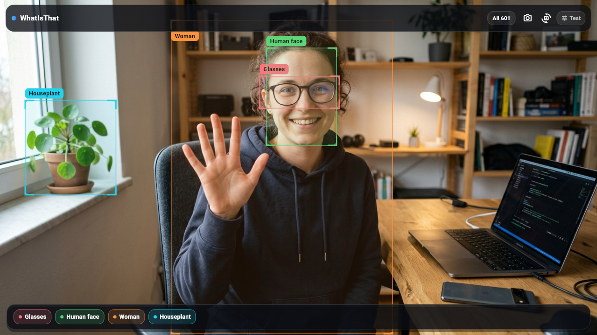
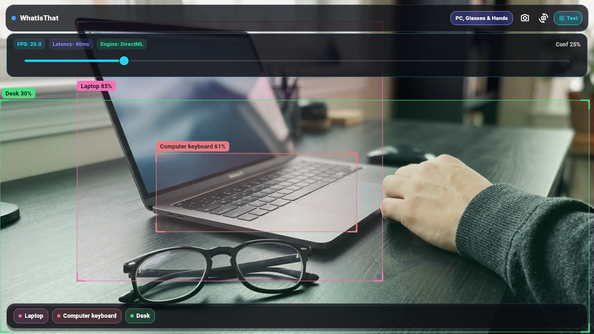

<p align="center">
  
</p>

<h1 align="center">WhatIsThat</h1>

<p align="center">
  <strong>Real-time, 100% offline AI camera object detection for Windows & Android</strong><br/>
  Detects <strong>601 everyday objects</strong> (PCs, laptops, keyboards, glasses, hands, phones, people & more) directly on-device with zero internet required.
</p>

---

## Live App Screenshots

### Default View (Clean Camera Mode)
Clean, lag-free dark-mode viewfinder showing bounding boxes, object names, camera switcher, quick preset filter, and the live detected-objects summary dock at the bottom.



### Test Mode (FPS, Latency & Confidence Tuning)
Toggle **Test** in the top-right bar to inspect live FPS, inference latency (`ms`), hardware execution engine (`NNAPI` / `XNNPACK` / `DirectML` / `CPU`), confidence percentages on boxes, and an adjustable confidence slider.



---

## Key Features

- **601-Class Offline AI (`YOLOv8n-OIV7` ONNX at `416×416`):** Detects **Glasses**, **Human hand**, **Laptop**, **Computer monitor**, **Computer keyboard**, **Computer mouse**, **Mobile phone**, **Headphones**, **Person**, and 590+ other Open Images V7 classes with no cloud API or internet connection.
- **Smooth, Zero-Queue Tracking:**
  - Never queues stale camera frames—always grabs the latest frame so moving hands, glasses, and devices stay in sync without trailing delay.
  - Background Dart `Isolate` preprocessing (direct letterbox sampling from `YUV420` / `BGRA8888`) + cache-friendly NMS decoding.
  - Adaptive IoU + EMA box smoothing eliminates jitter while snapping rapidly on fast motion.
- **Hardware Accelerated:** Uses `NNAPI` / `XNNPACK` on Android 10+ and `DirectML` / `CPU` on Windows 10+.
- **Dark-Mode Camera UI:**
  - Switch between front/back phone cameras or multiple PC webcams.
  - Quick filter toggle (**All 601** vs **PC, Glasses & Hands**).
  - One-tap annotated snapshot capture (`WhatIsThat_<timestamp>.png`).
  - **Test Mode** toggle (OFF by default for friends; ON for diagnostics & threshold tuning).

---

## Install & Share With Friends

### Android (`.apk`, Android 10+)
1. Download `WhatIsThat-Android.apk` (from `dist/WhatIsThat-Android.apk` or GitHub Releases).
2. Open the `.apk` on your Android phone and allow **"Install unknown apps"** when prompted.
3. Grant **Camera** permission on first launch and point your camera at anything!

### Windows (`Setup.exe`, Windows 10/11 64-bit)
1. Download `WhatIsThatSetup.exe`.
2. Double-click to run the setup wizard (creates Start Menu & optional Desktop shortcuts, no extra Python/CUDA setup needed).
3. Launch **WhatIsThat** and allow webcam access.

---

## Build From Source

### Prerequisites
- **Flutter SDK** `3.50.1+` (stable channel)
- **Android Build:** Android SDK (API 35/36) + NDK
- **Windows Installer Build:** Visual Studio 2022 (*Desktop development with C++*) + [Inno Setup 6](https://jrsoftware.org/isdl.php)

### 1. Export the 601-Class ONNX Model (already bundled in `assets/models/`)
```bash
python3 -m venv .venv
.venv/bin/pip install torch torchvision --index-url https://download.pytorch.org/whl/cpu
.venv/bin/pip install ultralytics onnx onnxslim onnxruntime pillow
.venv/bin/python tools/export_model.py
```

### 2. Run Tests & Analysis
```bash
flutter pub get
flutter analyze
flutter test
```

### 3. Build Android Universal APK (Linux / macOS / Windows)
```bash
./scripts/build_android.sh
# Output: dist/WhatIsThat-Android.apk
```

### 4. Build Windows Setup Wizard `.exe` (Windows 10/11)
```powershell
.\scripts\build_windows.ps1
# Output: dist\WhatIsThatSetup.exe
```

### 5. Build Linux Desktop Bundle (Ubuntu / Debian)
```bash
sudo apt install clang cmake ninja-build pkg-config libgtk-3-dev
./scripts/build_linux.sh
# Output: dist/WhatIsThat-Linux-x64.tar.gz
```

### 6. Automated Cloud Builds (GitHub Actions)
A ready-to-use workflow template for building both `WhatIsThatSetup.exe` and `WhatIsThat-Android.apk` on GitHub Actions is included at [`docs/github_release_workflow.yml`](docs/github_release_workflow.yml). Copy it to `.github/workflows/release.yml` in GitHub (requires `workflow` permission) to trigger cloud Windows + Android builds on every `v*` tag or manual run.

---

## Project Structure

```text
├── assets/
│   ├── icon/                        # App icon (PNG & multi-size Windows ICO)
│   └── models/                      # YOLOv8n-OIV7 ONNX (416x416) & 601 labels
├── docs/
│   ├── github_release_workflow.yml  # GitHub Actions CI/CD template (APK + Setup.exe)
│   └── screenshots/                 # App screenshots rendered with real ONNX output
├── installer/whatisthat.iss         # Inno Setup 6 Windows installer script
├── lib/
│   ├── main.dart                    # Dark-mode app entry point
│   ├── models/detection.dart        # Detection model, palette & preset filters
│   ├── services/
│   │   ├── box_tracker.dart         # IoU + adaptive EMA bounding-box smoother
│   │   ├── detector_service.dart    # ONNX Runtime session & Isolate pipeline
│   │   ├── image_preprocess.dart    # YUV420 / BGRA8888 direct letterbox tensorizer
│   │   └── yolo_postprocess.dart    # 601-class decoder & per-class NMS
│   └── ui/
│       ├── camera_detection_screen.dart
│       └── widgets/                 # Overlay painter, top bar, test panel, status dock
├── scripts/
│   ├── build_android.sh             # Build dist/WhatIsThat-Android.apk
│   └── build_windows.ps1            # Build dist/WhatIsThatSetup.exe
├── test/                            # Unit & widget tests
└── tools/                           # ONNX model export & icon/screenshot helpers
```
